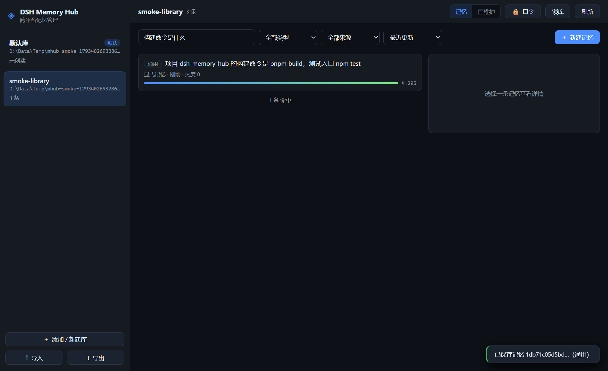

# DSH Memory Hub GUI

> **dsh-memory-hub 跨平台桌面记忆管理**——多库管理 / 编辑 / 检索 / 导入导出 / 加密口令管理，
> Windows · macOS · Linux 三平台交付（Electron 主进程直连存储核心，零运行时第三方依赖）。

`dsh-memory-hub` 插件 roadmap 的最后一项「跨平台 GUI 记忆管理（桌面级应用：编辑/导入导出 UI/多库管理）」的独立应用级交付物。领域语义（存储/检索/蒸馏协议/加密管线/导入幂等）**全部来自插件的 [`./core` 纯库出口](../dsh-memory-hub/src/core.ts)**——GUI 不复制任何实现，插件升维 GUI 免费受益。



## 功能总览

| 能力         | 说明                                                                                                                                                                           |
| ------------ | ------------------------------------------------------------------------------------------------------------------------------------------------------------------------------ |
| **多库管理** | 侧栏库列表（默认库 = `~/.dsh/memory-hub/memories.jsonl`，与 dsh 插件共享同一份记忆）；新建空库 / 添加既有库 / 重命名 / 移出列表；加密库 🔒 徽标与点击解锁                      |
| **编辑**     | 新建 / 编辑（append-only 版本推进，深回放历史保留）/ **取代**（supersede 协议：新版本打 `supersede:`、旧条目打 `superseded-by:` 召回降权）/ 删除（tombstone 软删除）/ 批量删除 |
| **检索**     | 六线融合召回（词面/容错/语义/图谱/推理/向量）+ 评分条 + **召回溯源 why**（各线贡献/融合模式/公共因子）；类型/来源/标签/工作区筛选与 facets 计数                                |
| **导入导出** | Markdown 文档 / 会话 JSONL / JSON 迁移包三源导入（入库计划预览 → 提交，内容级幂等 + 敏感零豁免）；导出 JSON 迁移包（跨设备闭环）+ 可视化检索页 HTML（自包含/离线/零外链）      |
| **加密口令** | 打开加密库口令解锁（错口令显式失败）/ 启用加密（明文库原位迁移）/ 口令轮换 / 解密回退 / 锁库（口令即刻出内存）；口令仅存活于主进程内存                                         |
| **维护视图** | 统计卡片（总量/体量/被取代/损坏行隔离/加密形态/结构版本）+ 类型与来源分布 + 主题聚类 + 记忆时间轴（近 90 天事件柱状图）+ 存储诊断                                              |

## 快速开始

```bash
# 前置：同级目录检出插件仓库并构建 ./core 出口
cd ../dsh-memory-hub && npm install && npm run build

cd ../dsh-memory-hub-gui
npm install          # 首次含 Electron 二进制下载
npm run dev          # 启动桌面应用（--dev 附加 DevTools）
```

| 命令                                           | 说明                                                                                                                                                                      |
| ---------------------------------------------- | ------------------------------------------------------------------------------------------------------------------------------------------------------------------------- |
| `npm run check`                                | 类型检查 + prettier + 37 项单元测试 + esbuild 构建                                                                                                                        |
| `npm run smoke`                                | **无头 E2E 冒烟**：16 步真实 DOM 用户旅程（多库→新建→检索→溯源→编辑→取代→删除→导入→双导出→维护→加密→锁库→解锁→解密），每步截图至 `smoke-artifacts/`，任一步失败退出码非 0 |
| `npm run icon`                                 | 纯 Node 生成应用图标（确定性 PNG，零图像依赖）                                                                                                                            |
| `npm run dist:win` / `dist:mac` / `dist:linux` | electron-builder 打包（NSIS+portable / dmg×2 架构 / AppImage+deb）                                                                                                        |

冒烟全程隔离（独立 userData + 临时目录），不触碰真实记忆库与注册表，可反复运行。

## 架构

```
┌─────────────────────────── Electron 主进程 ───────────────────────────┐
│  registry.ts   多库注册表（userData/libraries.json，原子写 + 损坏留证）  │
│  session.ts    会话门面（打开/编辑/检索/导入导出/口令生命周期）           │
│  ipc.ts        通道装配（入参运行期校验 + 结构化错误映射）               │
│      │ 全部委托                                                          │
│      ▼                                                                  │
│  dsh-memory-hub/core   JsonlMemoryStore · recall · makeEntry            │
│                        planImport · renderMemoryHtml · crypto 探测       │
└────────────┬───────────────────────────────────────────────────────────┘
             │ ipcRenderer.invoke（contextIsolation + sandbox，白名单通道）
┌────────────▼────────────────── 渲染进程 ───────────────────────────────┐
│  app.ts 编排 │ 记忆视图（检索+筛选+列表+详情/why） │ 维护视图（统计+时间轴） │
│  模态框：编辑器/取代 · 导入向导（预览→提交）· 导出 · 口令 · 新建库        │
│  DOM 一律 textContent（与插件可视化检索页同一注入纪律）                  │
└───────────────────────────────────────────────────────────────────────┘
```

- **零运行时第三方依赖**：esbuild 把主进程/preload/渲染层连同 `dsh-memory-hub/core` 全量打包进 `dist/`，electron-builder 只需 `dist + package.json`；
- **安全基线**：`contextIsolation: on`、`nodeIntegration: off`、`sandbox: on`、CSP 声明、IPC 入参逐通道校验；
- **语义对齐插件工具层**：创建/编辑与 `memory_store` 同一条敏感过滤防线（`containsSensitive` + `makeEntry maxChars=1000` + 空内容显式失败）。

## 测试

- `test/registry.test.ts` — 多库注册表（默认库注入/增删改/去重/原子持久化/损坏回退）
- `test/session.test.ts` — 真实 `JsonlMemoryStore` 上的完整闭环（编辑/检索 facets/取代/导入导出幂等/**加密口令全生命周期含密文落盘断言**）
- `test/ipc.test.ts` — 契约校验（畸形载荷防御）+ 桥端到端（对话框替身）
- `test/model.test.ts` — 渲染层纯模型（标签解析/协议徽标/why 文案）
- `smoke-artifacts/*.png` — 16 步 E2E 的逐步截图（人审工键）

## 与插件仓库的关系

| 仓库                                                              | 角色                                                                                    |
| ----------------------------------------------------------------- | --------------------------------------------------------------------------------------- |
| [`dsh-memory-hub`](https://github.com/beijingwahw/dsh-memory-hub) | 记忆核心（存储/检索/认知管线）+ cordis 插件；1.6.0 起新增 `./core` 纯库出口供本应用消费 |
| 本仓库                                                            | 独立应用级交付物（DESIGN-1.5 §9.4「另案推进」的落地）；CI 三 OS 矩阵跑同一套门禁与冒烟  |

## License

MIT
